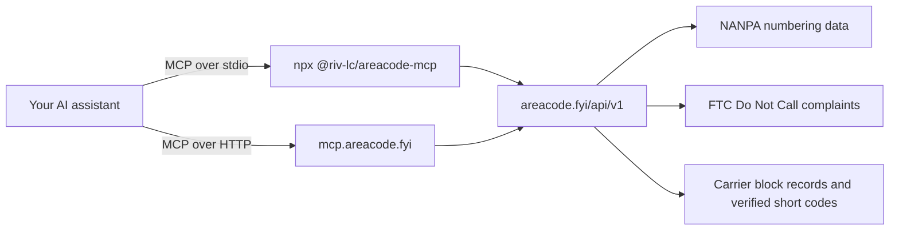

# areacode-mcp

**US and Canada phone-number intelligence for AI assistants.** Look up area codes, validate numbers, find the carrier behind a number block, check who texts from a short code, and explain phone scams, with every answer cited to its source.

[](https://www.npmjs.com/package/@riv-lc/areacode-mcp)
[](https://registry.modelcontextprotocol.io)
[](https://smithery.ai/servers/riv-lc/area-code)
[](LICENSE)

An [MCP](https://modelcontextprotocol.io) server backed by [areacode.fyi](https://areacode.fyi), which publishes directly from the official North American Numbering Plan (NANPA) database. Each result includes a canonical areacode.fyi URL and the date of its data, so your assistant can show where an answer came from.

## What you can ask

| Ask your assistant | Tool it uses |
| --- | --- |
| "A lead entered +1 702-555-0199. Where are they, and what time is it there?" | `lookup_phone_number` |
| "I got a call from 469. Is that area code a scam?" | `is_scam_area_code` |
| "Who texts from 26266?" | `lookup_short_code` |
| "Is 212-217-5500 a cell phone or a landline?" | `lookup_carrier` |
| "Which carrier is OCN 9104?" | `lookup_ocn` |
| "Which area codes cover Las Vegas?" | `area_codes_for_city` |
| "Explain neighbor spoofing for our help center." | `explain_area_code_topic` |

## Quick start

### Hosted server

Use this URL in any client that supports remote MCP servers, such as Claude (custom connectors) or ChatGPT (custom connectors):

```
https://mcp.areacode.fyi/mcp
```

The hosted server always runs the latest tools and data. Clients that only speak the older SSE transport can use `https://mcp.areacode.fyi/sse`.

### Claude Code

```bash
claude mcp add --transport http areacode https://mcp.areacode.fyi/mcp
```

Or run the package locally:

```bash
claude mcp add areacode -- npx -y @riv-lc/areacode-mcp
```

### VS Code

Add to `.vscode/mcp.json`:

```json
{
  "servers": {
    "areacode": {
      "type": "stdio",
      "command": "npx",
      "args": ["-y", "@riv-lc/areacode-mcp"]
    }
  }
}
```

### Any other MCP client

Most desktop clients read an `mcpServers` block (Claude Desktop uses `claude_desktop_config.json`):

```json
{
  "mcpServers": {
    "areacode": {
      "command": "npx",
      "args": ["-y", "@riv-lc/areacode-mcp"]
    }
  }
}
```

Restart the client and the tools are available. The package needs Node.js 18 or later.

## Tools

**Area codes**

| Tool | Returns |
| --- | --- |
| `lookup_area_code` | Country, state or province, principal and served cities, time zone, current local time, 10-digit dialing, overlays and nearby codes |
| `area_codes_for_city` | The area codes serving a US or Canadian city, with an optional state to tell same-named cities apart |
| `area_codes_for_state` | Every area code in a US state or Canadian province |

**Phone numbers and carriers**

| Tool | Returns |
| --- | --- |
| `lookup_phone_number` | Whether a number is valid, its E.164 form, area code, region, time zone and current local time |
| `lookup_carrier` | The carrier a number's block was assigned to, its line type (cell phone, likely VoIP, or landline or VoIP), its OCN and rate center |
| `lookup_ocn` | The carrier behind an OCN (operating company number), or a carrier's OCNs by name, with company type, area codes and number blocks held |

**Scams and texts**

| Tool | Returns |
| --- | --- |
| `is_scam_area_code` | Whether an area code is legitimate, spoofing context, and FTC Do Not Call complaint totals for numbers shown with that code |
| `check_number_reputation` | FTC Do Not Call complaint data for a number (count, robocall share, top subject, dates) and areacode.fyi's moderated community signal |
| `lookup_short_code` | Who texts from a US SMS short code: owner, what the texts are, how to opt out, how often the brand is impersonated, and the owner's own source page |
| `explain_area_code_topic` | Sourced explainers: neighbor spoofing, overlays and splits, toll-free numbers, area code vs country code, temporary numbers |

### Example result

`lookup_short_code` with `{"code": "26266"}` (trimmed; the full response adds a safety note):

```json
{
  "code": "26266",
  "owner": "United Airlines",
  "brand": "United Airlines",
  "is_reporting_code": false,
  "what_it_sends": "Flight status alerts for upcoming United trips, including delays and check-in reminders, by text or WhatsApp",
  "category": "other",
  "opt_out": "Text STOP; HELP for United contact info",
  "impersonation_risk": "medium",
  "source": "https://www.united.com/en/us/fly/text-messaging.html",
  "data_date": "2026-11-11",
  "canonical_url": "https://areacode.fyi/short-code/26266"
}
```

## How it works



The package is a thin client: each tool calls the public [areacode.fyi JSON API](https://areacode.fyi/api) and returns its response as-is. The hosted server calls the same API inside the site's Cloudflare Worker, so both always return the same answers.

## Data sources

| Data | Source | Refreshed |
| --- | --- | --- |
| Area codes, overlays, time zones | NANPA's official area code database | Weekly |
| Complaint counts | FTC Do Not Call "Reported Calls" data | Weekly |
| Carriers, line types, OCNs | Public NPA-NXX block assignments, via localcallingguide.com | Each pull is dated in the response |
| Short codes | Each owner's own published documentation | Each code carries its verified date |

Area-code facts are public records. Methods and definitions: [areacode.fyi/methods](https://areacode.fyi/methods).

## Use it responsibly

- An area code shows where a number is registered, not who is calling. Caller ID can be spoofed.
- Carrier data shows the carrier a number block was assigned to. If a number was ported, its current carrier differs.
- FTC complaint counts are reports consumers filed, not proof that a number's owner did anything wrong.
- A short code missing from the directory is unverified, not a sign of a scam.
- areacode.fyi is not a consumer reporting agency. Don't use this data for employment, credit, tenant or insurance decisions (FCRA).

## Configuration

| Environment variable | Default | Purpose |
| --- | --- | --- |
| `AREACODE_API_BASE` | `https://areacode.fyi` | Point the package at another host, such as a staging API |

The public API has no API key. For high-volume or commercial use, see [areacode.fyi/api](https://areacode.fyi/api).

## Development

```bash
npm ci
```

```bash
npm run build
```

Try the tools in the MCP Inspector:

```bash
npx @modelcontextprotocol/inspector node dist/index.js
```

### Releasing

`npm run release` (patch) or `npm run release:minor` bumps the version, syncs `server.json`, tags and pushes. The tag runs [`.github/workflows/release.yml`](.github/workflows/release.yml), which publishes to npm through trusted publishing with provenance.

## License

MIT © Reindex Ventures. Built for [areacode.fyi](https://areacode.fyi).
